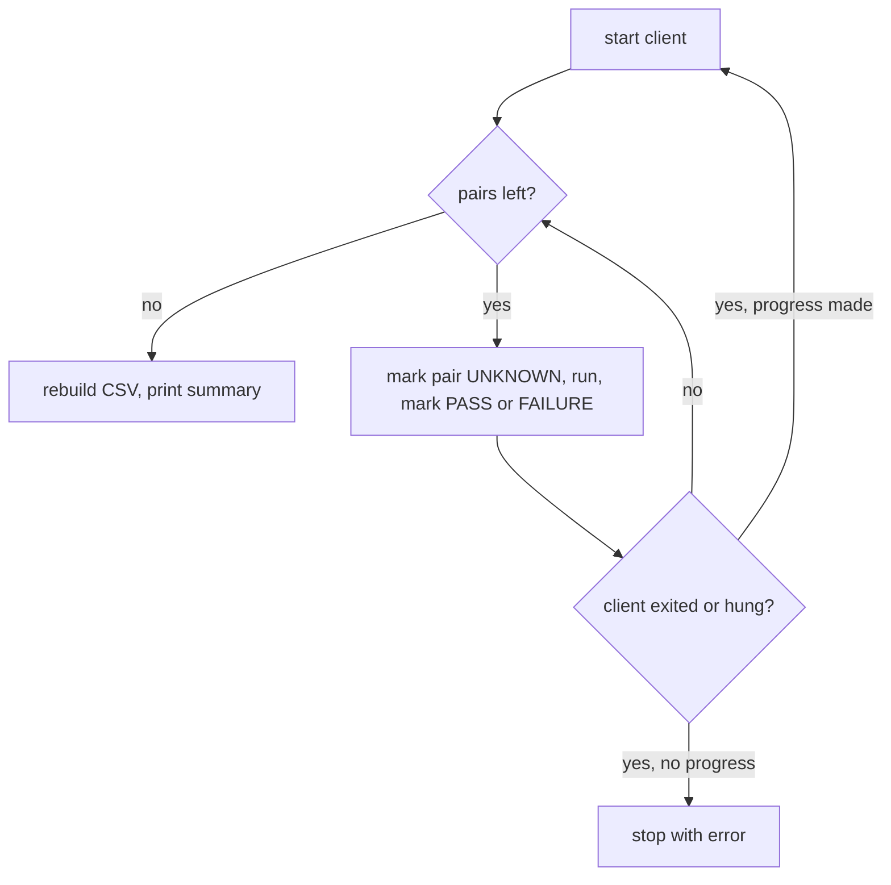

# Benchmark database

## What it is and why

A benchmark group runs every solution on every problem size. A kernel that crashes, faults the GPU or hangs used to kill the client, lose the data of the whole group and stop the pipeline.

With the benchmark database, which is enabled by default, the client records each (init config, solution) pair in a SQLite file, and a Python supervisor restarts the client, kills a hung one and rebuilds the results CSV from the database.

The contract:

- The `UNKNOWN` marker of a pair is committed durably before the pair is launched, so a crash or a node reset leaves it `UNKNOWN`.
- `PASS` or `FAILURE` is committed after the pair is validated.
- A pair left `UNKNOWN` is faulty and is never launched again.
- A faulty kernel is launched once: the remaining pairs of its solution are marked `INDIRECTLY_FAILED` or `INDIRECT_VERIFICATION_FAILURE` and are not launched.

| Value | Status | Meaning |
|-------|--------|---------|
| 0 | `NOT_BENCHMARKED` | Not started. |
| 1 | `UNKNOWN` | Started and never finished: the client died or was killed while running it. |
| 2 | `PASS` | Finished with validation `PASSED` or `NO_CHECK`, or with no verdict. |
| 3 | `FAILURE` | Finished with a verdict other than `PASSED` or `NO_CHECK`. |
| 4 | `INDIRECTLY_FAILED` | Never launched: its solution left another pair `UNKNOWN` in a session that died. |
| 5 | `INDIRECT_VERIFICATION_FAILURE` | Never launched: its solution failed verification (verdict `FAILED`) on another pair. |

### Schema at a glance

`schemaSql` in `client/src/BenchmarkDatabase.cpp` is the source of truth for the columns.

| Table | Purpose |
|-------|---------|
| `meta` | CSV options: `performance_metric`, `csv_export_extra_cols`, `csv_merge_same_problems`. |
| `solutions` | Complete solution spec, with `spec_format` `msgpack` or `yaml`. |
| `client_configs` | The client configuration as text, a single row. |
| `init_configs` | One row per problem. |
| `problem_values` | Per-problem values reported by the client. |
| `sessions` | One row per client launch. `end_time` stays NULL if the client died. |
| `runs` | One row per pair: status, session, times, validation, `caused_by_problem_id`. |
| `run_values` | Per-pair values as the text the CSV uses. |
| `iterations` | Time and enqueue count of each sync. |

Invariants:

- `PRAGMA user_version` is 1. A file with tables and another or no version is rejected with a mismatch and left unmodified, including databases of earlier local builds, which must be deleted.
- `runs.status` has `CHECK` 0 to 5, and `caused_by_problem_id` is non-NULL exactly for statuses 4 and 5.
- `run_values` and `iterations` have a composite foreign key to `runs(problem_id, solution_id)`.
- `runs(solution_id, status)` is indexed.
- Solution specs are the deterministic msgpack encoding of the solution, or YAML when the build has no msgpack writer. If the serialization traits change (the set or order of written fields), opening an old database fails with `solution N spec differs` and the run needs a new database.

## Usage

The mode is on by default. Turn it off with `BenchmarkDatabase: False` in `GlobalParameters` or `--global-parameters BenchmarkDatabase=False`. The standalone `tensilelite-client` stays opt-in with `--benchmark-db`.

| Parameter | Default | Meaning |
|-----------|---------|---------|
| `BenchmarkDatabase` | `True` | Record pairs, supervise the client, build the results CSV from the database. |
| `BenchmarkSolutionTimeout` | `600` | Seconds one pair may run before the client is killed. It is a safe limit for a single pair; a pair that legitimately needs longer needs a larger value. `0` disables the watchdog and a negative value is an error. |
| `BenchmarkIndirectFailures` | `True` | Mark the remaining pairs of a solution that crashed, faulted or hung as `INDIRECTLY_FAILED`. |
| `BenchmarkIndirectVerificationFailures` | `True` | Mark the remaining pairs of a solution that failed verification as `INDIRECT_VERIFICATION_FAILURE`. |

Turning an indirect option off resets the pairs previously marked with its status to `NOT_BENCHMARKED` at the next client start, so they are retried. Types are strict: the three booleans and the integer timeout raise `ConfigTypeError` otherwise.

The timeout window starts when `PairRecorder` commits `UNKNOWN` and ends when `recorder->finish()` runs after `postSolution`. It covers solving, warm-ups, enqueues, validation against the CPU reference, timing and post-solution reporting. It does not cover the per-problem CPU reference, the per-problem input preparation, client start-up, solution selection, `preSolution` and the WGMXCC setup, so hangs there are not detected.

The client options `indirect-failures` and `indirect-verification-failures` (default true) carry the two indirect parameters and are excluded from the compared configuration.

### ExitOnFails

The supervisor reports failure when any pair is `UNKNOWN`, `FAILURE`, `INDIRECTLY_FAILED`, `INDIRECT_VERIFICATION_FAILURE` or `NOT_BENCHMARKED`.

| `ExitOnFails` | Behavior |
|---------------|----------|
| `1` (default) | The benchmark step runs fully, then Tensile exits with 1 if any group failed. LibraryLogic does not run. |
| `0` | Tensile continues to LibraryLogic. Every non-`PASS` pair is `-1` in the CSV, so LibraryLogic skips it. |
| `2` | The client gets `exit-on-error`. If it stops early after a failure the supervisor does not resume it. A crash or hang is still restarted. |

### Restrictions

| Combination | Message |
|-------------|---------|
| `ParallelGpuExecution` other than 1 | `BenchmarkDatabase does not support ParallelGpuExecution != 1` |
| `NumBenchmarks` greater than 1 | `BenchmarkDatabase does not support NumBenchmarks > 1` |
| `CpuOnly` | `BenchmarkDatabase does not support CpuOnly` |
| `PredictionThreshold` of 1.0 or less (default 2.0) | `BenchmarkDatabase does not support PredictionThreshold <= 1.0` |
| Fused A2A problem type | `BenchmarkDatabase does not support fused A2A problem types` |
| More than one `ICacheFlush` value | `BenchmarkDatabase does not support multiple ICacheFlush values: the client rejects multiple icache-flush-args values` |

With `BenchmarkDatabase` unset, Tensile prints one line, `# <reason>; using the legacy benchmark mode`, and uses the legacy mode. Explicit `True` exits with the message above; explicit `False` uses the legacy mode silently.

The first four are global: `validateBenchmarkDatabaseParameters` decides once after the command-line overrides, and a fallback disables the mode for the whole run (several reasons are joined by commas). Fused A2A and multiple `ICacheFlush` values are per group, checked per step by `_checkBenchmarkDatabaseSupported`: only that group falls back, and the client ini carries the decision, since `benchmark-db` is written only for groups where the mode applies. The same decision selects result collection: a database group whose client left no CSV is skipped with a warning, a legacy group fails if the CSV is missing. The client-side `checkSupportedOptions` is only a backstop for direct invocations.

## Supervision

1. Tensile writes `benchmark-db=<...>/Data/00_Final.db` next to the results CSV. The Granularity config and each additional device-scalar-alpha mode get their own database.
2. The supervisor runs the client in its own process group.
3. The client opens the database, populating a new one or checking an existing one, and starts a session. Pairs of a solution left `UNKNOWN` by a died session are marked `INDIRECTLY_FAILED` at once.
4. For each pending pair it commits `UNKNOWN`, runs, then commits `PASS` or `FAILURE`. After a verdict `FAILED` the remaining pairs of the solution become `INDIRECT_VERIFICATION_FAILURE`, except in the session right after a session that died.
5. When no pair is `NOT_BENCHMARKED`, the supervisor rebuilds the CSV and prints a summary.



The supervisor decides from the database, not the exit code, which is the validation failure count of a finished client. A restart requires progress: a pair launched by, or newly marked by, the new session. The `NOT_BENCHMARKED` count is not used because a disabled indirect option raises it. Restarts are therefore bounded by the number of pairs.

The watchdog polls every 2 seconds. When a pair of a session started by this launch has been `UNKNOWN` longer than the timeout, it sends SIGTERM to the process group, waits 5 seconds and sends SIGKILL. Messages, with the `Tensile::WARNING:` prefix on the first two:

```
client failed (<how>); restarting to resume, <m> pairs left
problem <p>, solution <i> <name> has been running for <t>s, over the <limit>s limit; killing the client
# Client restarted <n> time(s) after crashes or hangs
```

`<how>` is `exit code <n>`, `killed by signal <n> (<NAME>)` or `killed by the watchdog`. `run.sh` reports a client killed by a signal as 128 + n, which is decoded as a signal only when the session did not end.

The supervisor reads the database for each decision. A missing database is the empty state. An unreadable one is retried 3 times, 1 second apart, then supervision stops with `could not read the benchmark database <db> after 3 attempts: ...; not judging the client without it`. The watchdog poll skips a failed read.

## Resume and rerun

- `ForceRedoBenchmarkProblems: True` (default) starts a fresh database: the `.db`, `-wal` and `-shm` files are deleted before the first launch of each config. Restarts inside the run resume.
- `False` resumes from the existing database. A group is skipped before anything is launched when `2_BenchmarkData/<problem type>_<outer>_<idx>.csv` exists (database and legacy groups alike). With `True` no group is skipped.
- A database group that is not skipped always launches the client, even if `Data/00_Final.csv` exists, because that CSV may be partial. A complete database makes the launch a no-op that regenerates the CSV.
- To start over with `False`, delete the `.db`, `-wal` and `-shm` files and the CSVs.
- A database containing `FAILURE` pairs, or any non-`PASS` pair, makes every client launch on it return 1 until it is deleted or `ForceRedoBenchmarkProblems` is `True`.

The client compares an existing database with the run: solutions (count, name, spec format, spec), client configuration, and init configs. A difference stops it before a session starts:

```
benchmark database mismatch: client configuration differs at '<option>'
benchmark database mismatch: solution <index> is named '<name in database>' in the database but '<name in this run>' in this run
benchmark database mismatch: solution <index> spec differs
benchmark database mismatch: solution count differs: database has <n>, run has <m>
```

The supervisor then stops with `client failed (<how>) before starting a benchmark session; see its output above. If the benchmark configuration changed since <db> was created, delete it to start over`, removes any stale CSV and the group is skipped. The client configuration contains absolute paths, so moving the output directory is a mismatch.

### Ductile

Each evaluation uses a fresh database whatever `ForceRedoBenchmarkProblems` says, because every generation has a different solution set. With `False`, Tensile prints a note and still starts fresh; resuming is done by the GA checkpoint `step-NN__ductile.checkpoint`. Restarts inside one evaluation resume. Non-`PASS` pairs are `-1` in the CSV. Indirect propagation only acts within one evaluation. The per-generation CSV copies in `2_BenchmarkData/GA_iters/` are kept, the databases are not.

## Crash handling

A crash, hang, GPU fault, lost device (`Device unusable (...), aborting.`) and a database error (`benchmark database error: ...`, exit 1) are all handled as a crash: the pair stays `UNKNOWN`, the session stays open and the client exits non-zero. At the next session start the remaining pairs of that solution become `INDIRECTLY_FAILED`.

After an abnormal exit (death by signal, watchdog kill, or a non-zero exit without a cleanly ended session) the supervisor runs `tensilelite-gpu-probe` on the client's `device-idx` before the next launch:

- The probe allocates two 128 MiB buffers, runs a copy kernel between them, reads the result back and verifies it.
- It makes up to 3 attempts of at most 120 seconds, logging `# gpu warm-up on device <d>, attempt <i>/3: passed` or a warning with the reason.
- If all fail, supervision stops with `gpu warm-up failed on device <d> after 3 attempts; not benchmarking on a possibly unhealthy gpu`. The warm-up stays pending and carries over to the next config, group or evaluation.
- The probe is looked up next to the client executable, then in the default build directory. If it is missing, one warning is printed and clients run without warm-up.

Failures in a session right after a session that died are tainted: they may be false failures after a GPU fault. Verification propagation is skipped there, and they are recorded and not retried.

## Shutdown

- SIGTERM and SIGHUP make the supervisor kill the client process group (SIGTERM, 5 seconds of grace, SIGKILL) and exit with 128 plus the signal. Ctrl-C kills the group the same way and re-raises. The handlers are installed only while supervising and only in the main thread. The database stays resumable.
- If the supervisor is SIGKILLed, on Linux `PR_SET_PDEATHSIG(SIGKILL)` kills the chain: `run.sh` and the probe are started with it, and the client in `benchmark-db` mode sets it on itself. A client whose parent is already dead exits with `benchmark-db client started after its supervisor exited`.
- After SIGKILL the supervisor waits at most `KILL_REAP_SECONDS` (30) for `run.sh`. If it does not exit, supervision stops with `client process <pid> did not exit after SIGKILL ...; not relaunching onto a GPU it may still hold`.

## Durability

Each commit uses `synchronous=FULL` (one fsync). WAL is required: on a filesystem without it the client fails with `cannot enable write-ahead logging`. The `-wal` and `-shm` files must be copied together with the `.db` and never deleted alone.

## Results and CSV

The summary printed after the run:

```
benchmark database: 18 pairs: 14 PASS, 0 FAILURE, 1 UNKNOWN, 0 NOT_BENCHMARKED, 3 INDIRECTLY_FAILED, 0 INDIRECT_VERIFICATION_FAILURE
pairs left UNKNOWN (the client died while running them):
  problem 0, solution 4 <solution name>
pairs not launched because their solution crashed, faulted or hung on another problem:
  solution 4 <solution name>: 3 pairs, caused by problem 0
sessions that died: 1
```

Sections list the `UNKNOWN` pairs, the `FAILED` pairs, the `INDIRECTLY_FAILED` and `INDIRECT_VERIFICATION_FAILURE` pairs per solution and causing problem, the tainted failures (failed right after a session that died) and the sessions that died.

Queries (`sqlite3 -readonly 00_Final.db`):

```sql
SELECT status, COUNT(*) FROM runs GROUP BY status;

SELECT c.problem_index, s.library_index, r.session_id
FROM runs r JOIN init_configs c ON c.id = r.problem_id JOIN solutions s ON s.id = r.solution_id
WHERE r.status = 1 ORDER BY c.problem_index, s.library_index;

SELECT c.problem_index, s.library_index, r.status, cc.problem_index AS caused_by
FROM runs r JOIN init_configs c ON c.id = r.problem_id JOIN solutions s ON s.id = r.solution_id
LEFT JOIN init_configs cc ON cc.id = r.caused_by_problem_id
WHERE r.status IN (4, 5) ORDER BY s.library_index, c.problem_index;
```

`tensilelite.BenchmarkDatabase` reads the database from Python:

```python
from contextlib import closing
from tensilelite.BenchmarkDatabase import RunStatus, getPairs, openDatabase

with closing(openDatabase("Data/00_Final.db")) as connection:
    for pair in getPairs(connection, [RunStatus.UNKNOWN]):
        print(pair.problemIndex, pair.libraryIndex, pair.sessionId)
```

Main functions: `openDatabase`, `getPairs`, `getSessions`, `countPairsByStatus`, `summarize`, `formatSummary`, `writeResultsCsv`.

The results CSV is generated by `writeResultsCsv`: it writes a temporary file and replaces the CSV atomically, from a single read snapshot, and writes `-1` for every non-`PASS` pair so LibraryLogic can parse it. A stored value that cannot be read raises `BenchmarkDatabaseError`; the supervisor prints a warning and writes no CSV.

### CSV parity test

The gtest `BenchmarkCsvParity*` (`tests/BenchmarkCsvParity_test.cpp`) and `Tests/unit/test_benchmark_csv_parity.py` share the fixtures in `tests/data/benchmark_db` (scenarios `default`, `merge`, `extra_cols`, `cu_efficiency`; a golden `<name>.csv` and a dump `<name>.db.txt` each). Both compare the CSV byte for byte. One deliberate deviation: the gtest replays never-reached pairs as `SKIPPED_BY_DB`, while a real client leaves their cell empty. To change a fixture, review the text the gtest prints on a mismatch, copy it over the file, and check the Python test. The Python tests derive the schema from `schemaSql` at test time.

## Build requirements

SQLite is required. CMake looks for the ROCm sysdeps config package in `${ROCM_PATH}/lib/rocm_sysdeps` first, then the system `libsqlite3`; configure fails if neither is found. With `msgpack-cxx` or `msgpackc-cxx` the host stores specs as msgpack, otherwise as YAML; the configure output has a status line for it. A client built against a host with neither writer rejects `--benchmark-db`.

## Known limitations

- A hang outside a pair is not detected, and the warm-up cannot rule out false failures.
- With `BenchmarkIndirectFailures` off, a faulty kernel can cost one restart per problem.
- Moving the output directory is a mismatch, and each restart repeats the client setup.
- `INVALID` (an exception while launching) is a direct failure and does not propagate; verification propagation is also skipped right after a session that died.
- The watchdog kills the whole group including `run.sh`, so its clock reset is skipped.
- A SIGKILLed supervisor releases the client lock while the client is still tearing down.
- The bounded reap only follows `run.sh`, a signal between starting the client and entering the cleanup scope is not covered, and the death-signal protection needs Linux.
- The combinations in the Restrictions table are unsupported.
